# IDDC: Intent-Driven Degradation Contracts

[](https://github.com/SAQLAINAP/Intent-Driven-Degradation-Contract/actions/workflows/ci.yml)
[](https://github.com/SAQLAINAP/Intent-Driven-Degradation-Contract/releases)
[](https://pkg.go.dev/github.com/SAQLAINAP/Intent-Driven-Degradation-Contract)
[](https://goreportcard.com/report/github.com/SAQLAINAP/Intent-Driven-Degradation-Contract)
[](LICENSE)
[](go.mod)

**Decide how your service degrades before it has to.** IDDC is a declarative failure-topology framework for distributed systems. You write a degradation contract next to your deployment, the compiler proves it has no gaps or contradictions, and a small runtime engine enforces it: it switches feature flags, buffers writes, scales pods, and waits for a human before making risky moves.

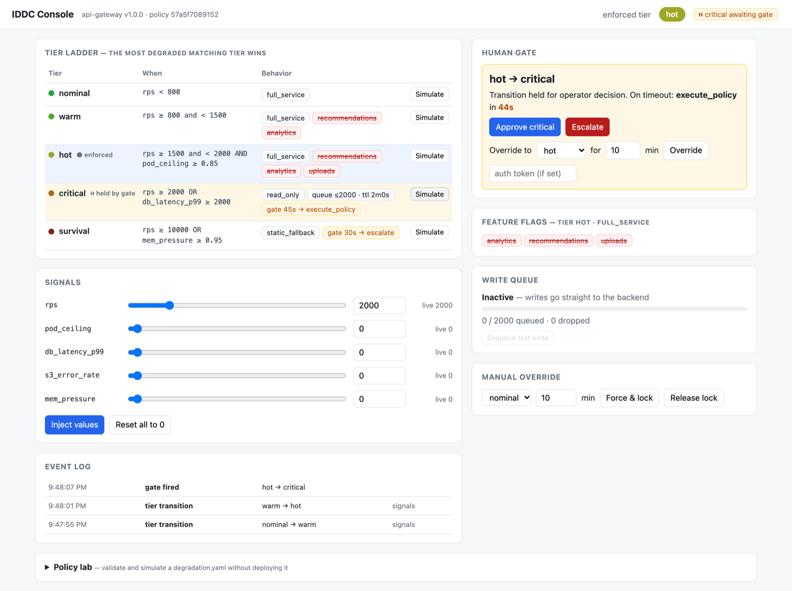

<table>
<tr>
<td width="33%"><strong>📜 Contract, not runbook</strong><br>Tiers, thresholds and behaviour live in <code>degradation.yaml</code>, reviewed like code and validated in CI.</td>
<td width="33%"><strong>🧮 Compiler that catches 3 AM bugs</strong><br>Tier gaps, undeclared signals, impossible ranges, dependency cycles, TTL vs recovery-SLA mismatches.</td>
<td width="33%"><strong>🧑‍✈️ Human gate</strong><br>Risky transitions are held until an operator approves, overrides or escalates, or until the timeout policy runs.</td>
</tr>
<tr>
<td><strong>🚦 Feature flags from policy</strong><br>A sidecar serves <code>/flags</code>; apps react to <code>mode</code> and <code>features</code>, never to tier names.</td>
<td><strong>🖥️ Built-in console</strong><br>Live ladder, signal sliders, gate controls, event log and a policy lab, with no extra process.</td>
<td><strong>📈 Observable</strong><br>Prometheus metrics, NDJSON audit log, Grafana dashboard, Slack and PagerDuty notifications.</td>
</tr>
</table>

> **Status:** pre-1.0. The DSL and the HTTP APIs may change between minor versions; see [CHANGELOG.md](CHANGELOG.md). Feedback and contributions are very welcome.

**Contents:**
[The problem](#the-problem) ·
[How it works](#how-it-works) ·
[Install](#install) ·
[Quick start](#quick-start) ·
[Screenshots](#screenshots) ·
[The console](#the-console-gui) ·
[Writing a policy](#writing-a-policy) ·
[CLI](#cli-reference-dg) ·
[Runtime behaviour](#runtime-behaviour) ·
[Configuration](#configuration-dg-engineyaml) ·
[API](#api-reference) ·
[Testing](#testing) ·
[Repository layout](#repository-layout) ·
[Known limitations](#known-limitations) ·
[Walkthrough](#walkthrough-a-bookshop-flash-sale) ·
[Contributing](#contributing) ·
[Roadmap](docs/ROADMAP.md)

---

## The problem

Service degradation is usually reactive. Engineers find out what their system does under load at 3 AM, mid-incident, with customers affected. Runbooks go stale, on-call responders make inconsistent decisions, and features get switched off in a different order every time.

IDDC turns that into a contract:

1. You write a `degradation.yaml` next to your `deployment.yaml`.
2. `dg compile` checks it for gaps, contradictions and cycles in CI, then emits a `.dg` bundle.
3. `dg-engine` enforces the bundle continuously. As signals cross thresholds it switches feature flags, buffers writes, and adjusts Kubernetes replicas.
4. Risky transitions wait behind a **human gate** until an operator approves them or the timeout policy takes over.

## How it works

```text
degradation.yaml ──► dg compile ──► policy.dg ──► dg-engine
                     parse, validate,             │
                     blast radius, emit           ├─ signal bus    Prometheus / HTTP / /proc / injected
                                                  ├─ evaluator     most degraded matching tier + hysteresis
                                                  ├─ enforcer      applies tiers; human gate holds risky ones
                                                  │    ├─ sidecar :8081   /flags for your app
                                                  │    ├─ write queue      buffer writes in read-only tiers
                                                  │    └─ k8s reconciler   replicas / HPA / rollouts / cordon
                                                  ├─ control API + web console :9191
                                                  ├─ gate callbacks :9292  (Slack / PagerDuty / curl)
                                                  └─ Prometheus metrics :9090, NDJSON audit log
```

New to IDDC? The [bookshop walkthrough](#walkthrough-a-bookshop-flash-sale) tells the whole story with diagrams.

The engine follows five rules:

| Rule | What happens |
|------|--------------|
| **Tier order** | Tiers are listed from least to most degraded. On every tick the engine picks the **most degraded tier whose condition matches**. If nothing matches, it uses the first tier. |
| **Hysteresis** | A new tier must stay matched for `up_hysteresis` (degrading) or `down_hysteresis` (recovering) before the transition is confirmed. This prevents flapping. |
| **Human gate** | A move *up* into a tier with `human_gate:` is **held**. Apps stay on the current tier until an operator answers or `wait` expires (see [Human gate](#human-gate)). Recovery (moving down) is never gated. |
| **Feature flags** | Come from the policy. A `full_service` tier enables every feature except its `disable:` list. `read_only` and `static_fallback` tiers disable everything. |
| **Write queue** | Tiers with `queue_writes:` buffer writes (`POST /write`). Leaving such a tier drains the queue. |

---

## Install

| Method | Command |
|--------|---------|
| **Go** (1.26+) | `go install github.com/SAQLAINAP/Intent-Driven-Degradation-Contract/cmd/dg@latest`<br>`go install github.com/SAQLAINAP/Intent-Driven-Degradation-Contract/cmd/dg-engine@latest` |
| **Binaries** | Download an archive for Linux, macOS or Windows from [Releases](https://github.com/SAQLAINAP/Intent-Driven-Degradation-Contract/releases). Each archive has `dg`, `dg-engine`, `demo-app`, example configs, and `checksums.txt`. |
| **Docker** | `docker run -p 8080:8080 -p 9191:9191 ghcr.io/saqlainap/iddc` (demo), or override the command with `bin/dg-engine …` |
| **Helm** | `helm install iddc ./deploy/helm/dg` (see [Kubernetes](#deployment-on-kubernetes)) |
| **Source** | `git clone https://github.com/SAQLAINAP/Intent-Driven-Degradation-Contract.git && cd Intent-Driven-Degradation-Contract && make build-all` → `bin/` |

Check the install with `dg --version`.

## Quick start

**Prerequisites:** Go 1.26+, `make`. Docker is optional; `curl` and `python3` are needed only for the smoke test.

```bash
git clone https://github.com/SAQLAINAP/Intent-Driven-Degradation-Contract.git
cd Intent-Driven-Degradation-Contract

make demo            # builds into bin/, compiles the example policy, starts engine + demo shop
```

Run `make` on its own to list every target.

| Open | What it is |
|------|------------|
| http://localhost:9191/ | **IDDC console**: tier ladder, signals, gate, flags, queue, overrides, policy lab |
| http://localhost:8080/ | **Demo shop**: a toy e-commerce app that obeys the sidecar's flags |

Port 8080 busy? Run `make demo DEMO_PORT=8088`.

To run it with Docker instead:

```bash
make docker-run      # = docker build -f deploy/docker/Dockerfile -t iddc-demo . && docker run -p 8080:8080 -p 9191:9191 iddc-demo
```

### A two-minute tour

1. In the console, click **Simulate** on the `warm` row. After about 3s of dev hysteresis, the enforced tier turns `warm` and `recommendations`/`analytics` switch off. The demo shop's feature table follows.
2. Click **Simulate** on `critical`. The gate opens, but the enforced tier **stays `warm`**: the console shows `warm → critical` with a countdown, and the shop keeps serving full checkout.
3. Click **Approve critical**. The tier becomes `critical` (`read_only`). Checkout in the demo shop now returns `202 queued`, and the write queue fills.
4. Click **Simulate** on `nominal` (or **Reset all to 0**). The service recovers and the queue drains (`queue_drained` shows in the event log).
5. Click **Simulate** on `survival`, then **Escalate**. The shop now serves its static 503 fallback page.
6. Use **Manual override → nominal → Force & lock**, then **Release lock**, to hand control back to the signals.

The same flow works with curl, for scripts and CI:

```bash
curl -XPOST localhost:9191/inject -d '{"rps": 2500}'   # propose critical (gated)
curl localhost:9292/gate/status                        # {"state":"pending","tier":"critical",...}
curl -XPOST localhost:9292/gate/approve                # apply it
curl localhost:8081/flags                              # {"tier":"critical","mode":"read_only",...}
```

---

## Screenshots

Captured from a live engine + demo shop session (the console was driven by clicking through it in headless Chrome) and from real terminal runs.

| | |
|---|---|
| **Console, `hot` tier.** Ladder, signals, flags and the event log (the gate view is at the top of this page).<br>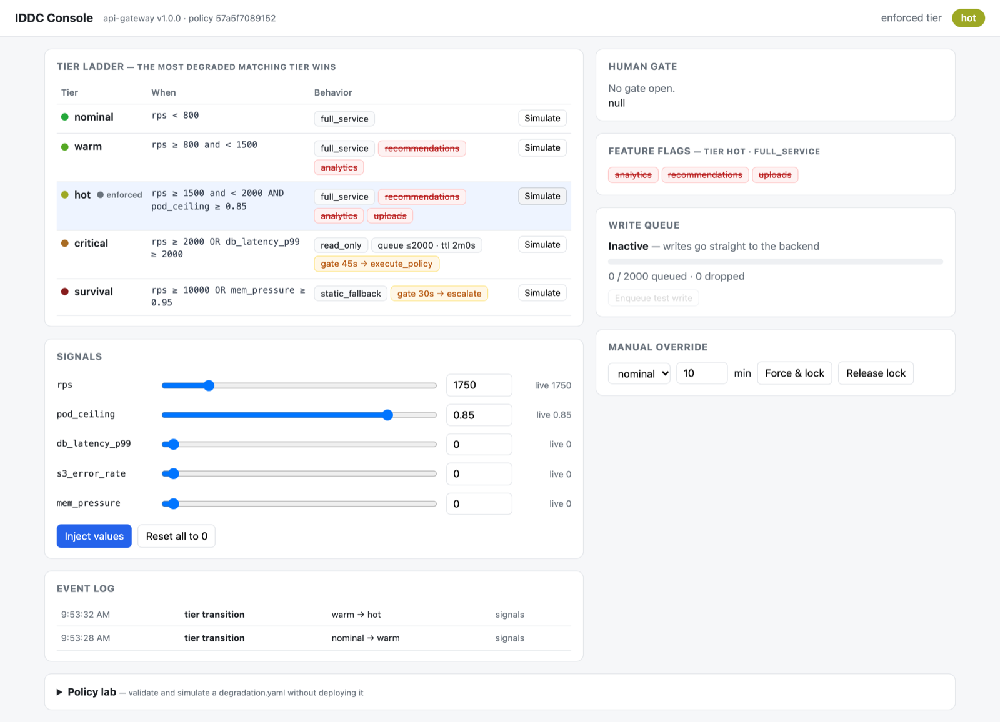 | **After approving the gate.** `critical` is enforced (read-only), features are off, writes are buffered.<br>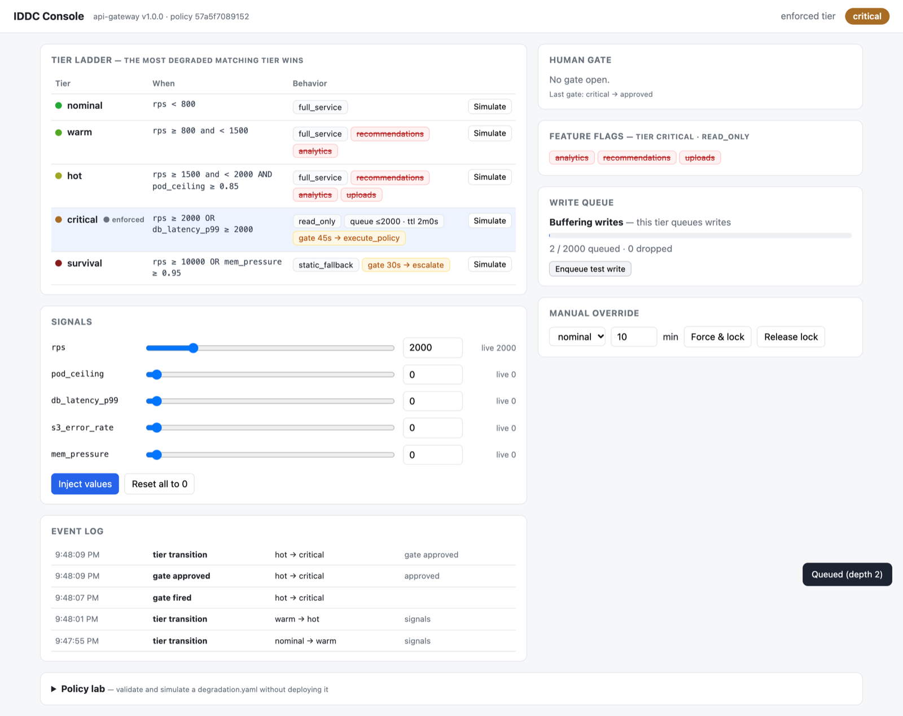 |
| **Demo shop in `critical`.** Reacts to the sidecar's mode and flags.<br>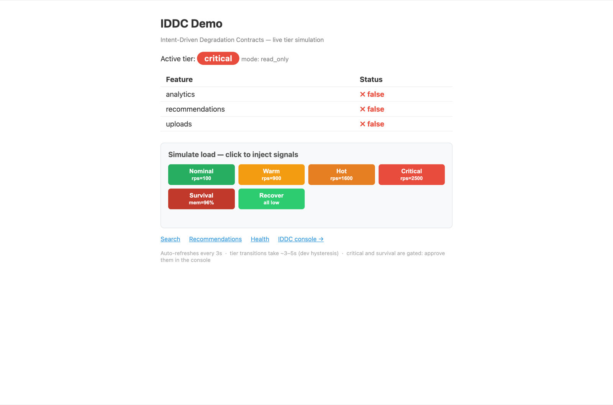 | **Demo shop in `survival`.** Static 503 fallback page.<br>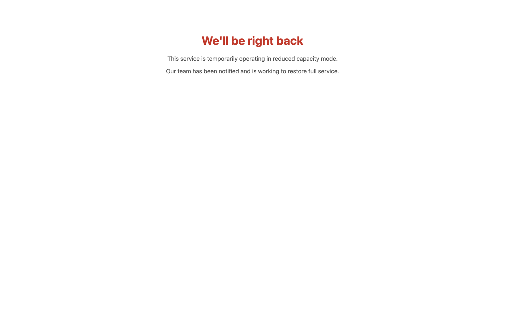 |
| **Policy lab.** Validates pasted YAML and flags a tier gap.<br>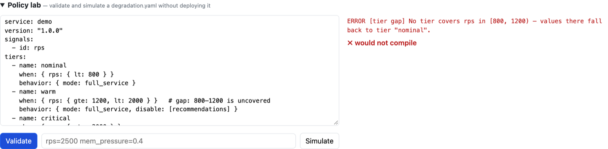 | **`make smoke`.** End-to-end checks against real binaries, all green.<br>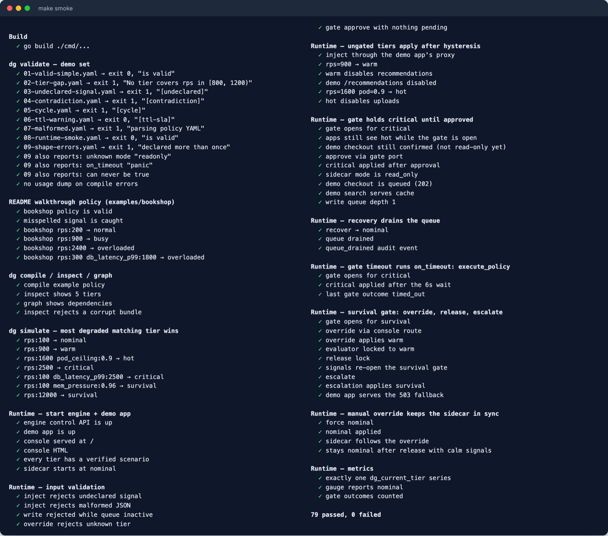 |

Terminal snaps: [`dg` diagnostics and simulate](#compiler-diagnostics), and [a `dg-engine` session with a gate held and then approved](#human-gate).

---

## The console (GUI)

The engine embeds a single-page console with no build step and no extra process. It's served on the control port (`:9191` by default) and polls the JSON API every second.

| Panel | What you can do |
|-------|-----------------|
| **Header** | Shows the enforced tier. Also shows *"⏸ X awaiting gate"* while a transition is held, and a 🔒 badge while the evaluator is locked. |
| **Tier ladder** | Each tier's condition, mode, disabled features, queue and gate settings. **Simulate** injects a verified set of signal values that lands exactly on that tier. |
| **Signals** | Slider and number input per signal, showing the live value the evaluator sees. Signals collected from live sources are read-only. |
| **Human gate** | Countdown, *from → to* tiers, and the on-timeout action. Buttons for **Approve**, **Escalate**, and **Override to** *tier* for *N* minutes. Optional auth token field. |
| **Feature flags** | Exactly what `GET :8081/flags` returns to your applications right now. |
| **Write queue** | Depth, capacity and drops. **Enqueue test write** is only enabled in queueing tiers. |
| **Manual override** | Force and lock any tier for N minutes; release the lock. |
| **Event log** | The in-memory tail of the audit log: transitions, gate events, overrides, queue drains. |
| **Policy lab** | Paste any `degradation.yaml` to validate it or simulate signal values against it, without deploying. |

> The control port can inject signals and override tiers, so treat it like an admin interface. Keep it on an internal network.

---

## Writing a policy

```yaml
service: api-gateway
version: "1.0.0"

signals:
  - id: rps
    source: prometheus
    query: sum(rate(http_requests_total{service="api-gateway"}[1m]))   # optional; defaults exist for common ids
    poll_cadence: 2s
  - id: db_latency_p99
    source: prometheus
  - id: mem_pressure
    source: proc                 # /proc/meminfo on Linux
  - id: queue_lag
    source: http
    url: http://worker:8080/stats
    field: lag                   # JSON field holding a number

tiers:                           # least → most degraded
  - name: nominal
    when: { rps: { lt: 800 } }
    behavior: { mode: full_service }

  - name: warm
    when: { rps: { gte: 800, lt: 1500 } }          # a comparator may combine a lower and an upper bound
    behavior:
      mode: full_service
      disable: [recommendations, analytics]

  - name: critical
    when:
      any_of:                                      # OR; all_of = AND; flat keys in one map are ANDed
        - rps: { gte: 2000 }
        - db_latency_p99: { gte: 2000 }
    human_gate:
      notify: ["slack:#incidents", "pagerduty"]
      wait: 45s
      on_timeout: execute_policy                   # execute_policy | hold | escalate
    behavior:
      mode: read_only
      queue_writes: { max_depth: 2000, ttl: 120s }

  - name: survival
    when: { mem_pressure: { gte: 0.95 } }
    behavior: { mode: static_fallback }

blast_radius:
  depends_on: [auth-service, user-db]
  cascade_to: [notification-service]
  isolation_boundary: payment-service
  recovery_sla_seconds: 120
```

| Field | Meaning |
|-------|---------|
| `signals[].source` | `prometheus` (needs `metrics.prometheus_url`), `http` (`url` + optional `field`), or `proc` (Linux). If a source can't be collected, the signal falls back to injected values. |
| comparators | `lt`, `lte`, `gt`, `gte`, `eq`. Combine a lower and an upper bound for a range. |
| `behavior.mode` | `full_service` (default), `read_only` (all flags off, writes queued if `queue_writes`), or `static_fallback` (all flags off, apps serve a 503 page). |
| `behavior.disable` | Feature names turned off in this tier. The union of every tier's list is the feature set the sidecar serves. |
| `human_gate.wait` | How long an operator has to respond. |
| `human_gate.on_timeout` | `execute_policy` applies the tier. `hold` stays on the current tier and locks it for 10 minutes. `escalate` jumps to the most degraded tier. |

### Compiler diagnostics

`dg validate` fails the build on errors and prints warnings. Every example below is in [`examples/demo-set/`](examples/demo-set):

| Category | Severity | Caught when… | Demo |
|----------|----------|--------------|------|
| `tier gap` | ERROR | A single-signal ladder leaves a range uncovered, including values above the top tier | `02-tier-gap.yaml` |
| `undeclared` | ERROR | A tier references a signal missing from `signals:` | `03-undeclared-signal.yaml` |
| `contradiction` | ERROR | A service is both `cascade_to` and `isolation_boundary`, or a comparator range is empty (`gte: 2000, lt: 1500`) | `04`, `09` |
| `cycle` | ERROR | The blast-radius graph has a cycle | `05-cycle.yaml` |
| `structure` | ERROR | Duplicate or missing tier name, or no tiers at all | `09-shape-errors.yaml` |
| `behavior` / `gate` | ERROR | Unknown `mode`, unknown `on_timeout`, or a gate without a positive `wait` | `09-shape-errors.yaml` |
| `ttl-sla` | WARN | Write-queue TTL is shorter than `recovery_sla_seconds` | `06-ttl-warning.yaml` |

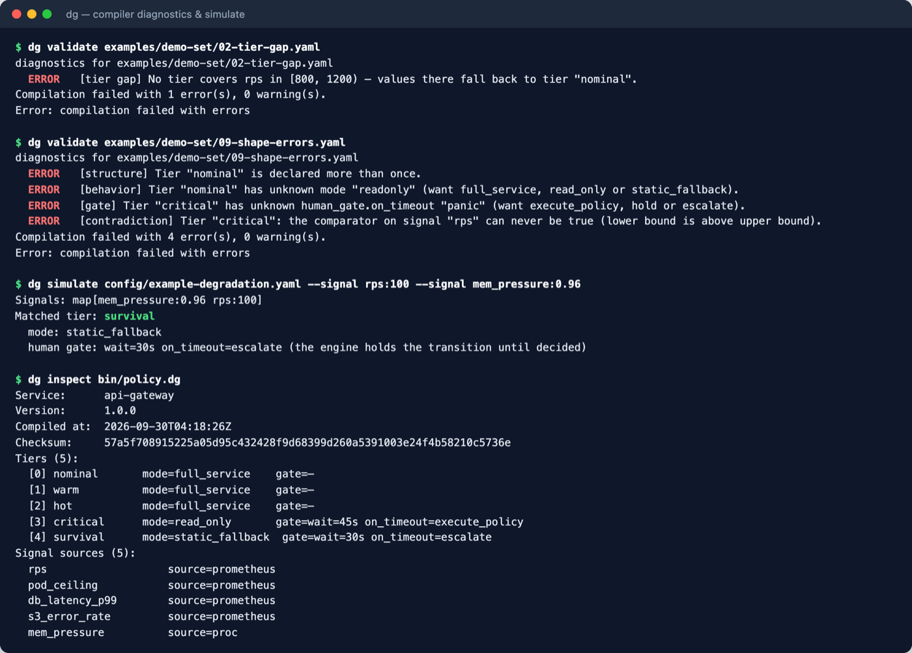

```text
$ dg validate examples/demo-set/02-tier-gap.yaml
  ERROR   [tier gap] No tier covers rps in [800, 1200) — values there fall back to tier "nominal".
Compilation failed with 1 error(s), 0 warning(s).

$ dg validate examples/demo-set/09-shape-errors.yaml
  ERROR   [structure] Tier "nominal" is declared more than once.
  ERROR   [behavior] Tier "nominal" has unknown mode "readonly" (want full_service, read_only or static_fallback).
  ERROR   [gate] Tier "critical" has unknown human_gate.on_timeout "panic" (want execute_policy, hold or escalate).
  ERROR   [contradiction] Tier "critical": the comparator on signal "rps" can never be true (lower bound is above upper bound).
```

Add it to CI:

```yaml
- name: validate degradation policy
  run: go run ./cmd/dg validate config/degradation.yaml
```

After `make build`, the binary is `bin/dg`.

---

## CLI reference (`dg`)

| Command | Description |
|---------|-------------|
| `dg validate <policy.yaml>` | Run every compiler check; exit 1 on errors |
| `dg compile <policy.yaml> [-o out.dg]` | Validate and emit the gob-encoded bundle (default `<policy>.dg`) |
| `dg inspect <bundle.dg>` | Print the service, checksum, tier ladder and signal sources |
| `dg graph <bundle.dg>` | Print the blast-radius tree |
| `dg simulate <policy.yaml> --signal id:value …` | Show the tier the engine would converge to, without hysteresis |
| `dg version` | Print the version |

```text
$ dg simulate config/example-degradation.yaml --signal rps:2500
Signals: map[rps:2500]
Matched tier: critical
  mode: read_only
  human gate: wait=45s on_timeout=execute_policy (the engine holds the transition until decided)
```

---

## Runtime behaviour

### Human gate

When the evaluator proposes moving *up* into a gated tier, the enforcer keeps the current tier applied and opens the gate. It sends Slack Block Kit and PagerDuty notifications if configured, and prints curl instructions to the terminal otherwise. Only one gate is open at a time.

| Operator action / event | Result |
|-------------------------|--------|
| `POST /gate/approve` | Gated tier is applied |
| `POST /gate/override {"target_tier","duration_min"}` | Target tier is applied and the evaluator is locked to it for `duration_min` (default 10) |
| `POST /gate/escalate` | Most degraded tier is applied and locked for 10 minutes |
| timeout + `execute_policy` | Gated tier is applied |
| timeout + `hold` | Current tier stays, locked for 10 minutes. The gate re-opens later if signals still demand it |
| timeout + `escalate` | Most degraded tier is applied and locked |
| signals move elsewhere first | The gate is **superseded** and the new proposal is handled normally |

Gate routes are served on the gate port (`:9292`) and mirrored on the control port for the console. If `gate.auth_token` is set, every response must include `"token": "…"`. A missing or wrong token returns `401`; answering when no gate is open returns `409`.

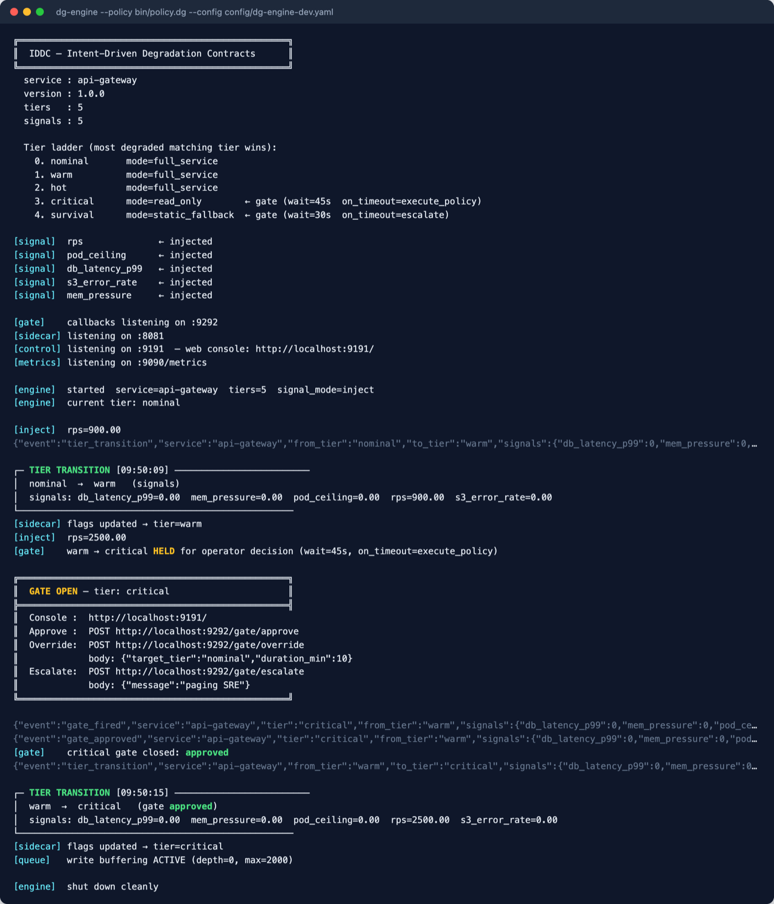

### Integrating your application

Your application asks the sidecar for flags on each request (or caches them for a second):

```go
resp, _ := http.Get("http://localhost:8081/flags")
var flags struct {
    Tier     string          `json:"tier"`
    Mode     string          `json:"mode"`     // full_service | read_only | static_fallback
    Features map[string]bool `json:"features"`
}
json.NewDecoder(resp.Body).Decode(&flags)

switch {
case flags.Mode == "static_fallback":
    // serve a static 503 page
case flags.Mode == "read_only":
    // serve cached reads; POST writes to http://engine:9191/write
case flags.Features["recommendations"]:
    // serve personalised recommendations
}
```

[`cmd/demo-app`](cmd/demo-app/main.go) is a complete example that reacts only to `mode` and `features`, never to tier names.

### Kubernetes enforcement

If `k8s.deployment_name` is set, every applied tier is reconciled through the Kubernetes REST API directly (no client-go):

- `warm`: scale to at least `target_warm`
- `hot`: scale to `max_pods` and pin the HPA
- `critical`: pause rollouts
- `survival`: pause rollouts and cordon nodes

These actions are keyed on those four tier names (see [Known limitations](#known-limitations)).

### Observability

| Metric | Type | Notes |
|--------|------|-------|
| `dg_current_tier{service,tier}` | gauge | One series per service: the **enforced** tier's ladder index (0 = least degraded) |
| `dg_signal_value{service,signal_id}` | gauge | Latest sampled value |
| `dg_tier_transitions_total{service,from_tier,to_tier}` | counter | Applied transitions |
| `dg_gate_events_total{service,outcome}` | counter | `approved` · `overridden` · `escalated` · `timed_out` · `superseded` |
| `dg_write_queue_depth{service}` / `dg_write_queue_dropped_total{service}` | gauge / counter | Write queue |

The audit log (stdout or a file, NDJSON) records `tier_transition` (with a `reason`), `gate_fired`, `gate_approved`, `gate_overridden`, `gate_escalated`, `gate_timed_out`, `gate_superseded`, `tier_override`, and `queue_drained`. `make observability-up` starts Prometheus (:9091) and a provisioned Grafana dashboard (:3000, admin/admin) from [`deploy/observability/`](deploy/observability).

---

## Configuration (`dg-engine.yaml`)

`${ENV_VAR}` placeholders are expanded at load time; unset variables become empty, which disables the integration that uses them. Every key is optional.

```yaml
server:
  control_addr: ":9191"      # control API + web console
  sidecar_addr: ":8081"      # feature flags for apps
  gate_addr: ":9292"         # gate callbacks

signal_bus:
  tick_interval: 2s
  stale_signal_timeout: 30s
  mode: auto                 # auto = declared sources; inject = everything via POST /inject

evaluator:
  up_hysteresis: 30s         # a degraded tier must hold this long before it's applied
  down_hysteresis: 90s       # recovery must hold this long

gate:
  slack_webhook_url: ${SLACK_WEBHOOK_URL}
  callback_base_url: https://dg.internal:9292
  auth_token: ${GATE_AUTH_TOKEN}
  pagerduty_routing_key: ${PAGERDUTY_ROUTING_KEY}

metrics:
  prometheus_port: 9090
  prometheus_url: http://prometheus:9090   # needed for source: prometheus

audit:
  output: stdout             # or a file path

k8s:
  namespace: production
  deployment_name: api-gateway   # empty = Kubernetes enforcement off
  target_warm: 6
  max_pods: 20
```

[`config/dg-engine-dev.yaml`](config/dg-engine-dev.yaml) uses 3s/5s hysteresis and `mode: inject` for demos. Don't use it in production.

---

## API reference

| Endpoint | Method | Description |
|----------|--------|-------------|
| `:9191/` | GET | Web console |
| `:9191/api/status` | GET | Enforced tier, proposed tier, lock, gate, flags, signals, queue |
| `:9191/api/policy` | GET | Tier ladder with human-readable conditions, verified scenarios, signal ranges |
| `:9191/api/events?n=50` | GET | Recent audit events, newest first |
| `:9191/api/validate` | POST | Body: policy YAML. Returns diagnostics |
| `:9191/api/simulate` | POST | `{"yaml": "…optional…", "signals": {…}}` → matched tier, mode and flags |
| `:9191/inject` | POST | `{"rps": 2500}`. Rejects undeclared or live-collected signals with 400 |
| `:9191/signals` | GET | Injected values |
| `:9191/write` | POST | `{"id","payload"}`. 409 unless the enforced tier queues writes |
| `:9191/write/depth` | GET | Depth, drops, active |
| `:9191/override` | POST | `{"tier","duration_min"}`. Force and lock a tier (400 for unknown tiers) |
| `:9191/override/release` | POST | Release the lock |
| `:9191/gate/*`, `:9292/gate/*` | — | `POST approve` · `POST override` · `POST escalate` · `GET status` |
| `:8081/flags` | GET | `{"tier","mode","features"}` for apps |
| `:8081/tier` | GET | Current tier, mode, since, signals |
| `:8081/health` | GET | Liveness |
| `:8081/override` | POST | `{"tier","token"}`. Sidecar-only override (bypasses the engine) |
| `:9090/metrics` | GET | Prometheus metrics |

---

## Testing

```bash
make fmt          # gofmt
make vet          # go vet
make lint         # golangci-lint v2
make test         # unit tests with the race detector
make test-cover   # the same, with a coverage summary
make smoke        # end-to-end smoke test (needs curl + python3)
```

A full run is pictured in [Screenshots](#screenshots).

`scripts/smoke.sh` runs its checks against real binaries:

- **CLI:** `dg validate` against every policy in `examples/demo-set/` (exit codes and exact diagnostics), `compile`/`inspect`/`graph`, corrupt-bundle handling, and a `simulate` matrix.
- **Runtime:** it starts `dg-engine` and the demo app, then walks the whole ladder over HTTP:
  - input validation
  - hysteresis
  - the gate holding a transition, then approve, timeout, override, lock release and escalate
  - write queueing and draining
  - the demo shop's read-only and 503 behaviour
  - manual overrides keeping the sidecar in sync
  - metrics hygiene

CI runs vet, unit tests, the smoke test, and example-policy validation on every push.

---

## Deployment on Kubernetes

The Helm chart in [`deploy/helm/dg`](deploy/helm/dg) runs `dg-engine` as a Deployment and Service from the `ghcr.io/saqlainap/iddc` image. It runs as non-root with a read-only root filesystem and has health probes.

```bash
# 1. Compile your policy and store it in the cluster
dg compile degradation.yaml -o policy.dg
kubectl create configmap dg-policy --from-file=policy.dg

# 2. Optional secrets (missing keys are simply left unset)
kubectl create secret generic dg-secrets \
  --from-literal=GATE_AUTH_TOKEN=$(openssl rand -hex 16) \
  --from-literal=SLACK_WEBHOOK_URL=https://hooks.slack.com/... \
  --from-literal=PAGERDUTY_ROUTING_KEY=<key>

# 3. Install; engine settings live under engineConfig in values.yaml
helm install iddc ./deploy/helm/dg \
  --set engineConfig.metrics.prometheus_url=http://prometheus-server.monitoring \
  --set engineConfig.k8s.deployment_name=api-gateway
```

Applications read `http://iddc-engine.<namespace>:8081/flags`. To run the engine next to your app instead, add a container with the same image and arguments to your pod (`/app/bin/dg-engine --policy … --config …`) and read `http://localhost:8081/flags`. Kubernetes enforcement needs RBAC to patch the target Deployment and its HPA. The chart doesn't create that role yet (see the [roadmap](docs/ROADMAP.md)).

---

## Known limitations

These are known gaps, and good first contributions. Each has an entry in the [roadmap](docs/ROADMAP.md):

- **Gap detection** covers ladders where every tier compares the same single signal. Compound (`all_of`/`any_of`) ladders aren't analysed, so a hole like `rps=1600, pod_ceiling=0.1` in the example policy (which falls back to `nominal`) isn't reported. Use `dg simulate` or the policy lab to check those.
- **Kubernetes actions** are keyed on the tier names `warm`, `hot`, `critical` and `survival`. Other names get no replica changes. The reconciler, Slack and PagerDuty paths are not covered by automated tests (they need a cluster or credentials).
- **Drained writes** are counted and logged but not replayed. Replaying them against your backend is left to the integrator (see `enforcer.applyLocked`).
- **`source: proc`** supports only `mem_pressure`, and only on Linux. Elsewhere it falls back to injection.
- Hysteresis windows apply to every tier, and only one gate can be open at a time.

---

## Repository layout

```text
.
├── cmd/                     entry points
│   ├── dg/                  CLI: validate, compile, inspect, graph, simulate, version
│   ├── dg-engine/           runtime engine, control API (control.go), web console (console.html, embedded)
│   └── demo-app/            demo shop that obeys the sidecar and uses the write queue
├── pkg/                     libraries
│   ├── policy/              DSL types + YAML loader
│   ├── compiler/            validation, blast-radius analysis, bundle emit
│   ├── runtime/             signal bus, tier evaluator (MatchTier), dispatcher, engine
│   ├── enforcement/
│   │   ├── enforcer/        applies tiers; human-gate hold / approve / timeout / supersede
│   │   ├── sidecar/         /flags server (flags derived from the policy)
│   │   ├── writequeue/      bounded TTL write buffer
│   │   ├── k8s/             Kubernetes REST client + reconciler
│   │   └── fallback/        static 503 page
│   ├── gate/                human gate, Slack, PagerDuty, callback server
│   ├── sigfetch/            Prometheus / HTTP / injected fetchers
│   ├── collector/           /proc collector (+ eBPF variant, build tag linux && ebpf)
│   └── audit/ metrics/ config/
├── config/                  example policy + engine configs (prod and dev)
├── examples/
│   ├── demo-set/            policies exercising every compiler diagnostic + the runtime smoke policy
│   └── bookshop/            the policy from the README walkthrough
├── deploy/
│   ├── docker/              Dockerfile for the demo image
│   ├── observability/       docker-compose for Prometheus + Grafana, with provisioning
│   └── helm/dg/             Helm chart for dg-engine
├── scripts/
│   ├── demo.sh              starts engine + demo shop (make demo, Docker image)
│   ├── smoke.sh             end-to-end smoke test (make smoke, CI)
│   └── release.sh           cross-platform release archives (make release-local, release workflow)
├── docs/screenshots/        images used in this README
├── internal/version/        build version stamped by the Makefile / release script
├── .github/                 CI and release workflows, issue/PR templates, Dependabot
├── Makefile                 `make` lists every target
├── render.yaml              Render blueprint (must live at the root)
├── CHANGELOG.md  CONTRIBUTING.md  CODE_OF_CONDUCT.md  SECURITY.md  LICENSE
└── docs/ROADMAP.md          planned work, open to contributors
```

Build output (`bin/`, `dist/`) is gitignored. `make clean` removes it, along with binaries that older versions of the Makefile left in the root.

---

## Walkthrough: a bookshop flash sale

This is an illustrative story, start to finish. A small online bookshop API adopts IDDC, then gets hit by a flash sale. The policy is in [`examples/bookshop/degradation.yaml`](examples/bookshop/degradation.yaml); every command output below is real.

### The big picture

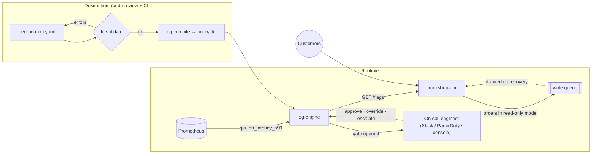

### 1. Write the contract

Next to the deployment files, the team adds `degradation.yaml`. In plain terms it says: shed extras when busy, and go read-only when overloaded, but only after a human has had a chance to say no.

```yaml
service: bookshop-api
version: "1.0.0"

signals:
  - id: rps                  # requests per second
    source: prometheus
  - id: db_latency_p99       # slowest 1% of DB queries, in ms
    source: prometheus

tiers:                       # least → most degraded
  - name: normal
    when: { rps: { lt: 500 } }
    behavior: { mode: full_service }

  - name: busy
    when: { rps: { gte: 500, lt: 2000 } }
    behavior:
      mode: full_service
      disable: [recommendations, reviews]      # shed the expensive extras

  - name: overloaded
    when:
      any_of:
        - rps: { gte: 2000 }
        - db_latency_p99: { gte: 1500 }
    human_gate: { wait: 60s, on_timeout: execute_policy }
    behavior:
      mode: read_only                          # browsing works, orders are buffered
      queue_writes: { max_depth: 5000, ttl: 10m }
```

Read as a state machine, the ladder looks like this (thresholds must hold for the hysteresis window before a move happens: 30s up and 90s down by default):

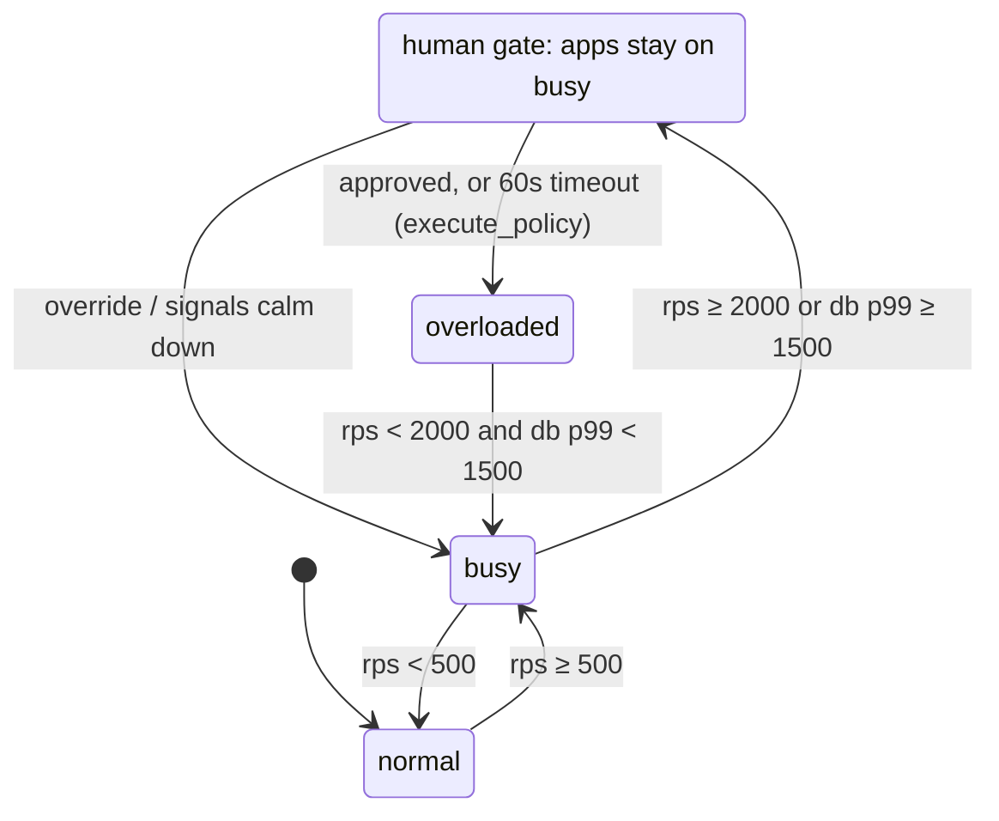

### 2. The compiler catches a mistake before it ships

Someone misspells a signal name in a later change. CI fails the build:

```text
$ dg validate degradation.yaml
  ERROR   [undeclared] Tier "overloaded" references signal "db_latancy_p99" but it is not declared in signals:
Compilation failed with 1 error(s), 0 warning(s).
```

Without the check, the slow-database trigger would have silently never fired. Once the typo is fixed:

```text
$ dg compile degradation.yaml -o policy.dg
✓  compiled → policy.dg  (service=bookshop-api  tiers=3)

$ dg simulate degradation.yaml --signal rps:300 --signal db_latency_p99:1800
Matched tier: overloaded        ← a slow database alone is enough
  mode: read_only
```

> Tier-gap detection only analyses ladders where every tier checks the same single signal. Because `overloaded` combines two signals, a gap in the `rps` bands of this policy would **not** be reported. `dg simulate` and the console's policy lab are the way to probe compound ladders (see [Known limitations](#known-limitations)).

### 3. Connect the app

`dg-engine` runs next to the API and serves feature flags on `:8081`. The app asks before doing optional work, and it reacts to `mode` and `features`, never to tier names:

```go
flags := getFlags("http://localhost:8081/flags")
// in busy: {"tier":"busy","mode":"full_service","features":{"recommendations":false,"reviews":false}}

if flags.Features["recommendations"] { showRecommendations() }
if flags.Mode == "read_only" { bufferOrder() }   // POST http://dg-engine:9191/write
```

### 4. Sale day

| Time | What's happening | What IDDC does | What customers see |
|---|---|---|---|
| 09:00 | 200 rps, DB fast | **normal** | Everything on |
| 09:05 | Sale starts: 900 rps | Proposes **busy** and waits 30s to be sure it isn't a blip | Everything still on |
| 09:05:30 | Still 900 rps | Applies **busy**; turns off `recommendations` and `reviews` | Fast pages, no "you may also like" |
| 09:10 | 2,400 rps, DB slowing | Proposes **overloaded**, a gated tier, so it **holds**: apps stay on `busy`, on-call is notified, and the console shows `busy → overloaded` with a 60s countdown | No change yet |
| 09:10:20 | On-call clicks **Approve** | Applies **overloaded**: `read_only`, write queue on. (With no answer, `execute_policy` would apply it at 60s anyway.) | Browsing works; "Order received, processing shortly" |
| 09:10–09:25 | Orders keep arriving | Orders are buffered (up to 5,000, kept 10 min) instead of hammering the database | Nobody sees an error page |
| 09:25 | Traffic falls to 700 rps | Waits 90s, then drops to **busy** and **drains the queue** | Checkout works normally again |
| 09:40 | Back to 150 rps | 90s later: **normal** | Everything back on |

What the on-call engineer could have done at 09:10 instead:

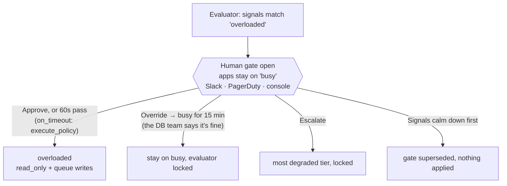

### 5. The paper trail

Every step is recorded as one NDJSON line in the audit log. This is the actual output from replaying the story:

```json
{"event":"gate_fired","service":"bookshop-api","tier":"overloaded","from_tier":"busy",…}
{"event":"tier_transition","service":"bookshop-api","from_tier":"busy","to_tier":"overloaded","reason":"gate approved",…}
{"event":"queue_drained","service":"bookshop-api","tier":"busy","count":3,…}
```

Prometheus has the same story as metrics (`dg_current_tier`, `dg_gate_events_total{outcome="approved"}`, `dg_write_queue_depth`), and the console's event log shows it live.

> **Heads-up:** draining currently hands the buffered writes back to the engine, which counts and logs them. Replaying them into your database is up to your integration (it's on the [roadmap](docs/ROADMAP.md)).

### Replay it yourself

```bash
make build-all
bin/dg compile examples/bookshop/degradation.yaml -o bin/bookshop.dg
bin/dg-engine --policy bin/bookshop.dg --config config/dg-engine-dev.yaml   # 3s/5s hysteresis
# in another terminal, play the sale:
curl -XPOST localhost:9191/inject -d '{"rps":900}'                          # → busy
curl -XPOST localhost:9191/inject -d '{"rps":2400,"db_latency_p99":900}'    # → gate opens
curl -XPOST localhost:9292/gate/approve                                     # → overloaded
curl -XPOST localhost:9191/write -d '{"id":"order-1"}'                      # buffered order
curl -XPOST localhost:9191/inject -d '{"rps":700,"db_latency_p99":40}'      # → busy, queue drained
curl -XPOST localhost:9191/inject -d '{"rps":150}'                          # → normal
```

Or open http://localhost:9191 and click through the same story in the console.

The point: the hard decision ("at 2,000 rps or a slow database we go read-only and buffer orders, but a human gets 60 seconds to say no") was made calmly in a code review, not by someone half-awake mid-incident. IDDC then carries it out the same way every time.

---

## Contributing

Contributions of every size are welcome: bug reports, docs, new signal sources, compiler checks, console features.

- Read **[CONTRIBUTING.md](CONTRIBUTING.md)** for the dev setup, the checks CI runs (`make fmt vet lint test smoke`), and a map of where things live.
- Look for issues labelled [`good first issue`](https://github.com/SAQLAINAP/Intent-Driven-Degradation-Contract/labels/good%20first%20issue), or pick something from the **[roadmap](docs/ROADMAP.md)**.
- Report bugs and propose features with the [issue forms](https://github.com/SAQLAINAP/Intent-Driven-Degradation-Contract/issues/new/choose).
- Report security problems privately, as described in **[SECURITY.md](SECURITY.md)**.

Everyone taking part is expected to follow the [Code of Conduct](CODE_OF_CONDUCT.md).

## Releases

Versions follow [SemVer](https://semver.org/), and every change is recorded in [CHANGELOG.md](CHANGELOG.md). Pushing a `v*` tag runs the [release workflow](.github/workflows/release.yml), which publishes binaries for Linux, macOS and Windows with checksums, plus the multi-arch `ghcr.io/saqlainap/iddc` image.

## License

IDDC is released under the [MIT License](LICENSE).

## Maintainer

**Saqlain Ahmed** ([@SAQLAINAP](https://github.com/SAQLAINAP)). Issues, pull requests and forks are all welcome. If IDDC is useful to you, a ⭐ helps others find it.
